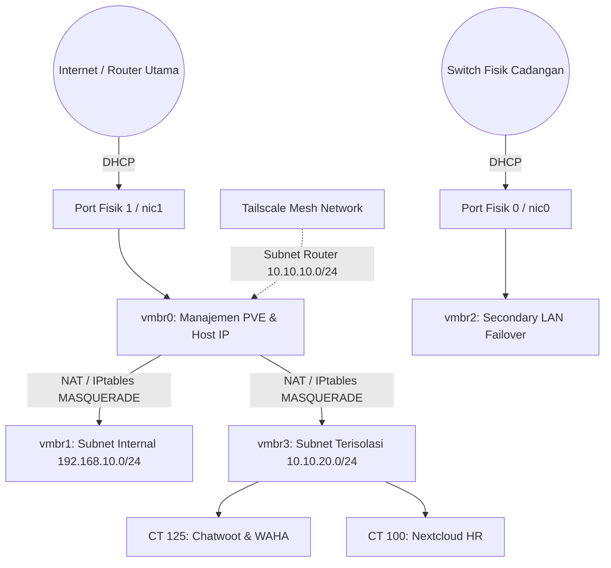

Dalam mengelola infrastruktur *homelab* atau *edge computing* yang menampung puluhan layanan produksi mikro (seperti *Chatwoot CRM*, *Nextcloud*, *database cluster*, hingga sistem pemantauan), keandalan dan segmentasi jaringan adalah fondasi paling krusial. 

Artikel ini mengulas arsitektur jaringan yang saya terapkan pada server **Proxmox VE (PVE)** dengan memanfaatkan dua port fisik kartu jaringan (*Dual Physical NIC*), pembuatan Linux Bridge bertingkat (`vmbr0` hingga `vmbr3`), serta akses aman via **Tailscale Mesh**.

---

## 🏗️ Topologi & Segmentasi Antarmuka

Berikut diagram alur perutean paket data antara dunia luar, host Proxmox, dan kontainer LXC terisolasi:



---

## ⚙️ Konfigurasi Inti `/etc/network/interfaces`

Pada instalasi Proxmox standar, antarmuka fisik kedua sering kali terabaikan dan dibiarkan dalam kondisi `NO-CARRIER`. Untuk memanfaatkannya sebagai jalur terisolasi yang mandiri, kita mendeklarasikan *Linux Bridge* sekunder:

```ini
# /etc/network/interfaces
auto lo
iface lo inet loopback

iface nic0 inet manual
iface nic1 inet manual

# 1. Primary WAN / LAN Management Bridge (nic1)
auto vmbr0
iface vmbr0 inet dhcp
	bridge-ports nic1
	bridge-stp off
	bridge-fd 0

# 2. Secondary Physical LAN Bridge (nic0)
auto vmbr2
iface vmbr2 inet dhcp
	bridge-ports nic0
	bridge-stp off
	bridge-fd 0

# 3. Dedicated Container NAT Bridge (Subnet Terisolasi 10.10.20.0/24)
auto vmbr3
iface vmbr3 inet static
	address 10.10.20.1/24
	bridge-ports none
	bridge-stp off
	bridge-fd 0
	post-up   iptables -t nat -A POSTROUTING -s '10.10.20.0/24' -o vmbr0 -j MASQUERADE
	post-down iptables -t nat -D POSTROUTING -s '10.10.20.0/24' -o vmbr0 -j MASQUERADE
```

### Keunggulan Desain Ini:
1. **Zero Exposure:** Kontainer di bawah `vmbr3` (seperti `10.10.20.125`) tidak memiliki IP publik dan tidak dapat diakses langsung oleh perangkat lain di WiFi/LAN rumah.
2. **Koneksi Internet Outbound:** Seluruh request keluar (update paket, webhook, API) tetap berjalan mulus melalui aturan `MASQUERADE` iptables ke antarmuka utama `vmbr0`.
3. **Pemisahan Jalur I/O:** Beban kerja intensif seperti transfer file cadangan (*backup stream*) dapat dialokasikan melewati `vmbr2` tanpa mengganggu lalu lintas manajemen di `vmbr0`.

---

## 🔒 Akses Aman Antar Titik Melalui Tailscale Subnet Router

Agar administrator dapat mengakses web GUI kontainer internal tanpa membuka port *forwarding* di router ISP (yang berisiko terkena serangan *port scanning*):

1. Host Proxmox dikonfigurasi sebagai **Tailscale Subnet Router**:
   ```bash
   tailscale up --advertise-routes=10.10.20.0/24,192.168.10.0/24 --accept-dns=false
   ```
2. Mengaktifkan *IP Forwarding* di level kernel Linux:
   ```bash
   echo 'net.ipv4.ip_forward = 1' | sudo tee -a /etc/sysctl.d/99-tailscale.conf
   sudo sysctl -p /etc/sysctl.d/99-tailscale.conf
   ```

Dengan konfigurasi ini, laptop atau perangkat mobile yang terhubung ke jaringan Tailscale dapat langsung membuka `http://10.10.20.125:3000` dari mana saja di seluruh dunia secara terenkripsi, dengan latensi rendah dan keamanan standar *WireGuard*.

---

## 💡 Kesimpulan

Dengan memisahkan segmen manajemen host, segmen aplikasi privat, dan mengamankan jalur masuk menggunakan *Zero Trust Network Access* (Tailscale), infrastruktur server mandiri dapat beroperasi dengan stabilitas setara fasilitas *data center* profesional.
