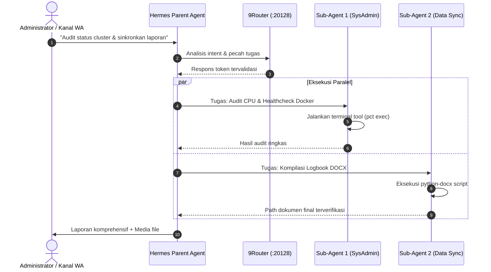

Perkembangan model bahasa besar (*Large Language Models / LLM*) telah bergeser dari sekadar antarmuka tanya-jawab (*chat interface*) menuju **agen otonom (*autonomous agents*)** yang mampu merencanakan (*plan*), mengeksekusi perintah (*tool execution*), mengaudit sistem, serta memantau infrastruktur secara berkelanjutan.

Dalam ekosistem produksi yang saya bangun, **Hermes Agent** difungsikan sebagai pengawas infrastruktur (*SRE Co-Pilot*) yang terhubung ke kanal komunikasi operasional WhatsApp dan Telegram. Artikel ini mengupas bagaimana pola kerja multi-agent dan gerbang inferensi lokal **9Router** menjamin keandalan sistem selama 24/7.

---

## 🏛️ Pola Arsitektur: Parent Agent & Sub-Agent Paralel

Menjalankan satu proses LLM monolitik untuk menyelesaikan seluruh pekerjaan berisiko mengalami *context pollution* dan latensi tinggi. Solusi terbaik adalah menerapkan pendekatan **delegasi tugas independen**:



### Prinsip Operasional Sub-Agent:
1. **Isolated Context:** Setiap sub-agent berjalan dalam lingkungan terisolasi dengan sesi terminal dan memori jangka pendek mandiri.
2. **Deterministic Output:** Hasil pekerjaan sub-agent divalidasi oleh skema JSON sebelum dilaporkan kembali ke parent agent.
3. **CPU Threshold Gating:** Delegasi paralel dibatasi secara dinamis apabila beban CPU server melebihi batas 80%, guna mencegah lonjakan *system load*.

---

## ⚖️ 9Router: Menjaga Ketersediaan Inferensi (Zero-Downtime)

Tantangan utama mengandalkan API LLM publik adalah batas kuota (*rate limiting*), lonjakan latensi, atau *provider outages*. Untuk mengatasinya, seluruh permintaan inferensi diarahkan melalui **9Router** yang berjalan pada port lokal `20128`.

```
                    ┌───────────────┐
                    │ 9Router Gate  │ (127.0.0.1:20128)
                    └───────┬───────┘
          ┌─────────────────┼─────────────────┐
          ▼                 ▼                 ▼
   ┌─────────────┐   ┌─────────────┐   ┌─────────────┐
   │ Vertex AI   │   │ Gemini CLI  │   │ OpenRouter  │
   │ (Tier 1)    │   │ (Tier 2)    │   │ (Fallback)  │
   └─────────────┘   └─────────────┘   └─────────────┘
```

### Logika Failover Cerdas:
* **Round-Robin Prioritas Gratis:** Memaksimalkan alokasi free-tier dari provider terverifikasi (Gemini Pro, Antigravity, GitHub Models) sebelum menyentuh API berbayar.
* **Health Check & Exponential Backoff:** Jika sebuah model mengembalikan status HTTP `429 (Too Many Requests)` atau `503 (Service Unavailable)`, 9Router langsung mengalihkan rute ke penyedia berikutnya dalam hitungan milidetik tanpa memutus proses yang sedang berjalan di agen.
* **Zero Kill Policy:** Layanan inferensi lokal ini dilindungi oleh aturan ketat agar tidak pernah dimatikan oleh skrip otomatis mana pun, menjamin agen selalu memiliki akses komunikasi.

---

## 💻 Contoh Integrasi Tool Execution yang Aman

Agen otonom diberikan akses untuk menjalankan perintah shell dengan proteksi *destructive mutation policy*. Sebelum perintah destruktif dijalankan, agen wajib membuat salinan cadangan (*pre-execution snapshot*) ke direktori aman:

```python
import subprocess
import os

def safe_system_mutator(target_file, command):
    # 1. Verifikasi integritas & buat backup terenkripsi
    if os.path.exists(target_file):
        backup_cmd = f"cp -a {target_file} ~/.vault-secure/{os.path.basename(target_file)}.bak"
        subprocess.run(backup_cmd, shell=True, check=True)
    
    # 2. Eksekusi mutasi dengan batasan timeout
    result = subprocess.run(command, shell=True, capture_output=True, text=True, timeout=30)
    
    # 3. Validasi exit code
    if result.returncode != 0:
        raise RuntimeError(f"Command gagal (Exit {result.returncode}): {result.stderr}")
    return result.stdout
```

---

## 🎯 Pandangan ke Depan

Masa depan otomasi IT dan rekayasa perangkat lunak terletak pada kolaborasi harmonis antara manusia dan agen otonom. Dengan arsitektur failover inferensi yang tangguh dan kontrol akses berbasis keamanan siber yang ketat, AI dapat menjadi mitra kerja yang bekerja tanpa henti di balik layar.
