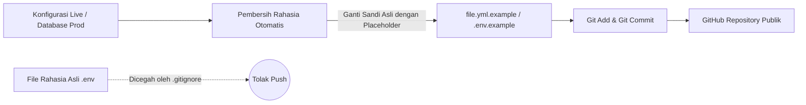

Kebocoran kredensial (*credential leak*) adalah salah satu vektor ancaman keamanan nomor satu dalam ekosistem *open-source* dan *homelab*. Sering kali, pengembang tanpa sengaja mengunggah file `.env`, token API bot, atau kunci SSH pribadi ke repositori publik GitHub saat melakukan pengarsipan proyek.

Dalam standar operasional yang saya terapkan, aturan **Zero-Leak Policy** diberlakukan secara ketat: tidak boleh ada kata sandi, token, maupun *private key* yang tersimpan dalam format teks biasa (*plaintext*) di repositori, naskah riset, maupun prompt agen.

Artikel ini membedah teknik pertahanan berlapis untuk memastikan repositori kode tetap aman dan siap dipublikasikan tanpa rasa was-was.

---

## 🛡️ Arsitektur Penyimpanan Terisolasi (`~/.vault-secure`)

Seluruh rahasia sistem dipisahkan dari direktori kerja biasa dan ditempatkan pada partisi/folder dengan kontrol hak akses Linux (*POSIX Permissions*) tingkat tinggi:

```
~/.vault-secure/                <-- Direktori izin 700 (drwx------)
├── api/
│   ├── github.conf             <-- Izin 600 (-rw-------)
│   └── tailscale-api.key       <-- Izin 600 (-rw-------)
├── passwords/
│   └── parrot-xsur.pass        <-- Izin 600 (-rw-------)
└── backups/
    └── *.tar.gz.enc            <-- Terenkripsi AES-256
```

### Penegakan Izin Akses Otomatis:
```bash
# Mengunci direktori rahasia agar hanya user pemilik yang bisa membaca
chmod 700 ~/.vault-secure
find ~/.vault-secure -type f -exec chmod 600 {} +
```

---

## 🔍 Mekanisme Sanitasi Template Sebelum Git Push

Setiap konfigurasi kontainer (seperti `docker-compose.yml` atau naskah *initializer* Rails) wajib melewati lapisan sanitasi variabel sebelum masuk ke pelacakan Git:



### Contoh Template Sanitasi Aman:
```yaml
# docker-compose.yml.example
services:
  database:
    image: postgres:15-alpine
    environment:
      POSTGRES_USER: ${POSTGRES_USER:-admin}
      POSTGRES_PASSWORD: ${POSTGRES_PASSWORD:-your_strong_password_here}
      POSTGRES_DB: ${POSTGRES_DB:-production_db}
```

---

## 🚫 Konfigurasi `.gitignore` Berlapis

Jangan pernah hanya mengandalkan ingatan saat menjalankan `git add .`. Pastikan file `.gitignore` pada akar repositori secara agresif mengecualikan segala bentuk ekstensi berbahaya:

```gitignore
# Security & Credential Protection
*.env
*.env.*
!*.env.example
*.key
*.pem
*.pass
*.token
*.sqlite3
*.db
*.bak
*.bak_*
id_rsa
id_ed25519
*.conf.secret
```

---

## 🔐 Audit Pra-Komit Menggunakan Regular Expression

Sebelum mengeksekusi `git push`, buat skrip pemindai cepat (*pre-commit check*) untuk mendeteksi apakah ada pola token (seperti GitHub PAT `ghp_`, bot token Telegram, atau private key) yang tidak sengaja tertinggal di dalam berkas teks:

```python
import os
import re
import sys

SECRET_PATTERNS = [
    r"ghp_[a-zA-Z0-9]{36}",             # GitHub Classic Token
    r"\d{9,10}:[a-zA-Z0-9_-]{35}",      # Telegram Bot Token
    r"-----BEGIN (RSA|OPENSSH) PRIVATE", # SSH Private Keys
    r"ey[A-Za-z0-9-_=]+\.[A-Za-z0-9-_=]+" # JWT Token
]

def scan_repository(repo_path):
    violations = 0
    for root, _, files in os.walk(repo_path):
        if ".git" in root:
            continue
        for f in files:
            p = os.path.join(root, f)
            with open(p, "r", errors="ignore") as file_content:
                text = file_content.read()
                for pattern in SECRET_PATTERNS:
                    if re.search(pattern, text):
                        print(f"[!] POTENSI KEBOCORAN KREDENSIAL: {p}")
                        violations += 1
    if violations > 0:
        print(f"\n[DITOLAK] Ditemukan {violations} potensi kebocoran. Git push dibatalkan.")
        sys.exit(1)
    print("[BERSIH] Seluruh file bebas dari kredensial eksplisit.")

if __name__ == "__main__":
    scan_repository(".")
```

---

## 💡 Ringkasan Praktik Terbaik

1. **Pisahkan Kode & Konfigurasi:** Jangan pernah membubuhkan *hardcoded password* pada baris kode program.
2. **Gunakan Secret Manager / Environment Injection:** Masukkan kredensial saat runtime melalui variabel sistem atau berkas `.env` lokal yang di-exclude dari Git.
3. **Enkripsi File Backup:** Bila berkas konfigurasi perlu dicadangkan ke *cloud*, selalu enkripsi menggunakan algoritma standar industri seperti AES-256 atau GPG.
